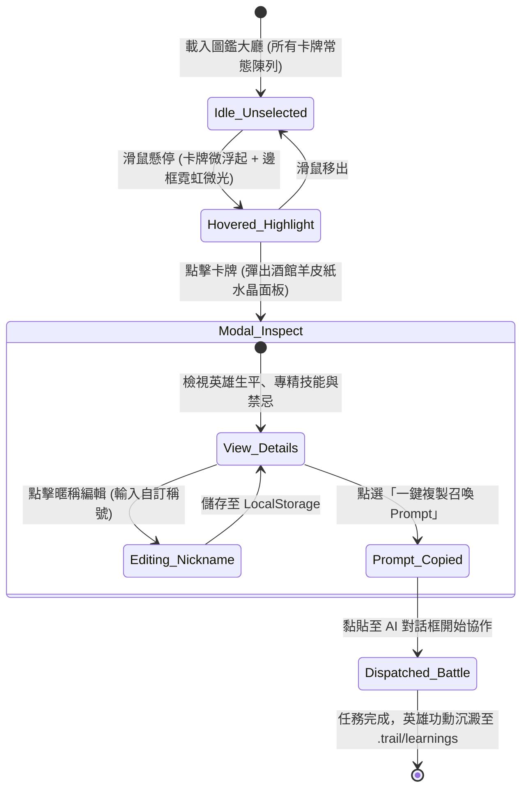
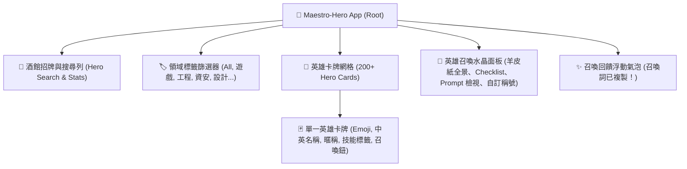

# ⚔️ Maestro-Hero 視覺化跨領域 AI 英雄角色圖鑑大廳系統分析與架構藍圖 (SA & GDD)

> **專案代號**：`Maestro-Hero: Tavern of 200+ Agents`  
> **發起出品人**：Baby（富二代出品人）  
> **總製作人 / 技術總監**：瀨戶環奈 (Seto Kanna) & 安齋らら (Rara Anzai)  
> **特邀聯合架構團隊**：
> - 🎮 **遊戲系統與循環主設計師**：`GameDesigner`（來自 Agency Agents 遊戲研發小組）
> - 📐 **視覺體驗與設計系統架構師**：`ArchitectUX`（來自 Agency Agents 設計小組）
> - 🤖 **多智能體系統架構總監**：`MultiAgentArchitect`（來自 Agency Agents 工程小組）
> **歸屬存放路徑**：`D:\Project\2026\AI_Agent_Tools\MasterHeroList\`  
> **當前版本**：`v1.0.0-Industrial`  
> **發布日期**：2026-10-30

---

## 📖 目錄 (Table of Contents)
- [1. 宏觀背景、業務痛點與出品人願景](#1-宏觀背景業務痛點與出品人願景)
- [2. 三位一體立體表達法：第一層 · 實體與角色定義卡片](#2-三位一體立體表達法第一層--實體與角色定義卡片)
- [3. 三位一體立體表達法：第二層 · 系統拓撲與狀態機流轉圖](#3-三位一體立體表達法第二層--系統拓撲與狀態機流轉圖)
- [4. 三位一體立體表達法：第三層 · 領域分組與彩色狀態徽章矩陣](#4-三位一體立體表達法第三層--領域分組與彩色狀態徽章矩陣)
- [5. 核心遊戲化機制與心流設計 (Game Loop & Psychology)](#5-核心遊戲化機制與心流設計-game-loop--psychology)
- [6. 暗黑電玩風 UI/UX 視覺設計系統 (Cyber-Fantasy Theme)](#6-暗黑電玩風-uiux-視覺設計系統-cyber-fantasy-theme)
- [7. 資料結構規範：`agents_catalog.json` 綱要規格](#7-資料結構規範agents_catalogjson-綱要規格)
- [8. 核心掃描萃取器 `scan_agents.py` 工程實作規範](#8-核心掃描萃取器-scan_agentspy-工程實作規範)
- [9. 前端單頁應用 (`index.html`) 組件階層架構](#9-前端單頁應用-indexhtml-組件階層架構)
- [10. 非功能性指標與異常邊界守衛 (NFR & Defensive Guards)](#10-非功能性指標與異常邊界守衛-nfr--defensive-guards)

---

## 1. 宏觀背景、業務痛點與出品人願景

### 1.1 宏觀背景
當前開源世界中湧現出大量頂尖的專業 AI Persona（如本倉庫所收錄的 `agency-agents`，內含 23 大領域、超過 200 位頂級專家）。每一份 Markdown 角色設定都蘊含了該領域頂尖專家的思考模型、檢核清單（Checklist）與行為邊界。

### 1.2 當前使用者面臨的「三大血淚痛點」
1. 📂 **「檔案迷宮脫窗痛點」**：200 多個角色散落在數十個深層資料夾中，使用者必須肉眼翻閱幾百個英文檔名，根本記不住「哪個檔案專門算抽卡數值」、「哪個檔案專門審核 HIPAA 醫療法規」。
2. 🏷️ **「多實例同職位區隔痛點」**：在電玩研發或大型專案中，同一個職業（例如「遊戲數值策劃」）可能需要同時召喚多位，且各自專精不同（例如「數值狂魔・老張」負責戰鬥力曲線、「經濟平衡・小李」負責商城通貨），既有的冷冰冰檔名無法為同角色賦予個人化暱稱與獨立實例識別。
3. 💬 **「上下文記憶爆炸痛點」**：若將全部 200 位專家的 Prompt 塞進系統提示詞，將直接吞噬數十萬 Token，導致 LLM 推理延遲暴增、幻覺頻發且記憶崩潰。

### 1.3 出品人 Baby 的神級願景 (The Vision)
打造一個 **單一檔案、零伺服器依賴、開箱即用、具備 3A 級暗黑電玩 RPG 風格的「英雄召喚酒館大廳 (Hero Tavern)」**！
- 使用者如同一位親臨冒險者公會的領主，以視覺化卡牌形式俯瞰所有英雄。
- 支援以「領域（Domain）」與「戰鬥職業（Role）」秒級動態過濾。
- 支援自由替英雄更換專屬代號/自訂暱稱（Custom Nickname）。
- 提供「一鍵召喚（複製 Prompt / 派遣出戰）」，讓當前的 AI 助理瞬間載入該英雄的完整靈魂！

---

## 2. 三位一體立體表達法：第一層 · 實體與角色定義卡片

```
┌────────────────────────────────────────────────────────────────────────┐
│ 👤 實體 1：[PRODUCER] 領主出品人 (Baby / 老公)                          │
├────────────────────────────────────────────────────────────────────────┤
│ 職掌邊界：全域最高決策者，制定專案目標、指派戰役、審查提案與把關預算。  │
│ 權限級別：👑 領域主宰 (Root Authority)                                │
│ 互動模式：點選圖鑑卡牌、自訂專屬分身暱稱、一鍵複製召喚詞或派遣進任務票。│
└────────────────────────────────────────────────────────────────────────┘

┌────────────────────────────────────────────────────────────────────────┐
│ 👤 實體 2：[HERO-AGENT] 跨領域專家英雄 (Hero Agent Persona)            │
├────────────────────────────────────────────────────────────────────────┤
│ 職掌邊界：承載特定垂直領域的專業心智模型、KPI 指標、Checklist 與邊界。 │
│ 實體屬性：ID, 英文名, 中文職業名, 領域類別, 圖標 Emoji, 顏色主題, 簡介,│
│           自訂暱稱, 核心技能標籤, 完整系統提示詞 (Full Prompt)。         │
│ 稀有度分級：Legendary (主架構師) / Epic (領域特化) / Rare (支援工具)   │
└────────────────────────────────────────────────────────────────────────┘

┌────────────────────────────────────────────────────────────────────────┐
│ 👤 實體 3：[HERO-INSTANCE] 英雄出戰分身 (Custom Hero Instance)         │
├────────────────────────────────────────────────────────────────────────┤
│ 職掌邊界：由出品人客製化命名的戰鬥實例（例如：數值狂魔・高橋）。        │
│ 實體屬性：InstanceID, ParentHeroID, CustomNickname, AssignedMission,   │
│           DispatchTimestamp, SessionMemoryScope。                      │
│ 儲存媒介：瀏覽器 LocalStorage（重整畫面不丟失，100% 離線私密）。        │
└────────────────────────────────────────────────────────────────────────┘

┌────────────────────────────────────────────────────────────────────────┐
│ 👤 實體 4：[TAVERN-SCANNER] 圖鑑地圖繪製者 (Metadata Parser)            │
├────────────────────────────────────────────────────────────────────────┤
│ 職掌邊界：負責於本機遍歷 agency-agents 資源包，萃取 YAML Frontmatter，  │
│           正規化中文翻譯與技能樹，壓製成標準 JSON 圖鑑快取。             │
│ 核心工具：Python 3.10+ / PyYAML / 正則表達式高效解析器。                 │
└────────────────────────────────────────────────────────────────────────┘
```

---

## 3. 三位一體立體表達法：第二層 · 系統拓撲與狀態機流轉圖

### 3.1 Maestro-Hero 總體系統拓撲架構圖

```mermaid
flowchart TB
    subgraph Storage["📦 本機資源庫 (Local Disk)"]
        RawMD["📂 D:/Project/2026/AI_Agent_Tools/agency-agents/<br/>200+ 專家 Markdown 角色檔 (含 YAML Frontmatter)"]
        Scanner["🐍 scan_agents.py<br/>自動萃取與中文翻譯標籤化引擎"]
        Catalog["📄 agents_catalog.json<br/>結構化角色圖鑑本機資料庫 (約 1.2MB)"]
    end

    subgraph TavernUI["🏰 Maestro-Hero 視覺化酒館 (Single Page App)"]
        direction TB
        FilterBar["🔍 多維過濾器 (領域標籤 / 職業搜尋 / 稀有度過濾)"]
        HeroGrid["🎴 英雄卡牌展台 (3D 懸浮動態 / 職業徽章 / 技能晶片)"]
        Modal["📜 英雄召喚水晶面板 (自訂暱稱 / 查看完整 Checklist / 一鍵複製)"]
        LocalStorage["💾 本地戰令儲存 (自訂英雄暱稱與最近常用陣容)"]
    end

    subgraph AIWorkspace["🧠 實戰作戰現場 (Antigravity / Gemini Workspace)"]
        PromptBuffer["📋 系統剪貼簿 / Prompt 注入通道"]
        ActiveBattle["⚔️ 承接任務：UOF 表單重構 / 鼎泰豐 WFM 策略排程 / 遊戲 GDD 數值"]
    end

    RawMD -->|掃描解析| Scanner
    Scanner -->|生成| Catalog
    Catalog -->|非同步載入| TavernUI
    FilterBar --> HeroGrid
    HeroGrid -->|點擊檢視| Modal
    Modal <-->|持久化客製暱稱| LocalStorage
    Modal -->|一鍵召喚 (Copy Prompt)| PromptBuffer
    PromptBuffer -->|載入專家思維| ActiveBattle

    style Storage fill:#fdf2f8,stroke:#ec4899,stroke-width:2px,color:#831843
    style TavernUI fill:#eff6ff,stroke:#3b82f6,stroke-width:2px,color:#1e3a8a
    style AIWorkspace fill:#f0fdf4,stroke:#22c55e,stroke-width:2px,color:#14532d
```

---

### 3.2 英雄卡牌與召喚狀態機 (Hero Card State Machine)



---

## 4. 三位一體立體表達法：第三層 · 領域分組與彩色狀態徽章矩陣

> **狀態徽章圖例 (Legend)**：  
> `🟢 完整就緒`：卡牌設定極度成熟，具備完整技能與檢核清單。  
> `🟡 擴展支援`：具備核心 Prompt，支援客製微調。  
> `🟣 稀有專家`：極高難度垂直領域（如逆向工程、遊戲數值平衡、醫療隱私）。  
> `🔒 安全審計`：涉及破壞性攻擊測試或高資安敏感性。

| 領域分類 (Domain) | 代表職業 (Role) | 預設英文代碼 | 稀有度評級 | 核心技能樹 (Skill Chips) | 落地防護與調用公約 |
| :--- | :--- | :--- | :---: | :--- | :--- |
| **🎮 遊戲研發 (Game Dev)** | 主數值平衡策劃 | `game-economy-designer` | `🟣 稀有專家` | 抽卡期望值、通貨膨脹抑制、成長曲線 | 產出數值必須附帶數學公式驗證，嚴禁拍腦袋調參。 |
| **🎮 遊戲研發 (Game Dev)** | 戰鬥機制架構師 | `combat-mechanics-designer` | `🟢 完整就緒` | 幀數判定、霸體與破韌、受擊手感回饋 | 必須定義前搖、判定框與後搖硬直時間表。 |
| **🎮 遊戲研發 (Game Dev)** | 關卡敘事架構師 | `narrative-designer` | `🟢 完整就緒` | 世界觀編年史、分支對白、環境敘事 | 遵守故事聖經 (Lore Bible)，對白嚴禁現代黑話出戲。 |
| **💻 軟體工程 (Engineering)** | .NET 架構大師 | `dotnet-architect` | `🟢 完整就緒` | C# 12、SOLID 原則、策略模式、DRY 實踐 | 嚴禁出現超過 3 層的巢狀 if-else，優先策略模式。 |
| **💻 軟體工程 (Engineering)** | 前端精靈使 (Vue/Tailwind) | `frontend-developer` | `🟢 完整就緒` | Vue 3 Script Setup、Pinia 抽離、微動效 | 像素級幾何對齊，遵循深模組 (Deep Modules) 設計。 |
| **💻 軟體工程 (Engineering)** | 多代理人系統指揮官 | `multi-agent-architect` | `🟣 稀有專家` | DAG 工作流、衝突消解、上下文負載平衡 | 單代理人記憶體邊界嚴格控制在 2,000 Token 以內。 |
| **🛡️ 資訊安全 (Security)** | 滲透測試黑客 | `penetration-tester` | `🔒 安全審計` | OWASP Top 10、SQLi、JWT 偽造、提權 | 僅限在合法本機與測試沙盒發動，嚴禁未授權攻擊。 |
| **🛡️ 資訊安全 (Security)** | 縱深防禦架構師 | `devsecops-engineer` | `🟢 完整就緒` | WAF 規則、靜態語法掃描、密鑰防洩漏 | 嚴禁明文金鑰寫入任何程式碼或日誌。 |
| **🏥 專業領域 (Specialized)** | 醫療隱私合規稽核官 | `healthcare-compliance-officer` | `🟣 稀有專家` | HIPAA、身分證遮罩、病歷三級加密 | 醫療敏感數據一律採 AES-256 GCM 欄位級加密。 |
| **📊 產品與專案 (Product)** | 雙軌敏捷指揮官 | `agile-pmp-orchestrator` | `🟢 完整就緒` | 垂直切片 (Vertical Slice)、WBS、工時燃盡 | 對內敏捷看板，對外一鍵編譯成厚重 PMP 瀑布規格。 |

---

## 5. 核心遊戲化機制與心流設計 (Game Loop & Psychology)

由我們的 **Game Designer** 專家親自操刀設計，徹底擺脫傳統後台管理系統的死板冷感：

```
┌────────────────────────────────────────────────────────────────────────┐
│ 🎮 Moment-to-Moment (瞬間快感 · 0～15 秒)                               │
├────────────────────────────────────────────────────────────────────────┤
│ 1. 視覺回饋：滑鼠掠過英雄卡牌時，卡牌輕微浮起 6px，背後綻放專屬職業光暈│
│    （戰士金黃光、法師幽藍光、刺客紫霧、工匠琥珀綠）。                 │
│ 2. 聽覺回饋 (可選 Web Audio API)：低頻水晶共振音效，營造探尋神秘酒館氛圍│
│ 3. 搜尋體驗：即時模糊搜尋，打一個字毫秒級剔除無關卡牌，如同翻動實體卡牌│
└────────────────────────────────────────────────────────────────────────┘

┌────────────────────────────────────────────────────────────────────────┐
│ 🏰 Session Loop (會話成就 · 1～5 分鐘)                                  │
├────────────────────────────────────────────────────────────────────────┤
│ 1. 挑選英雄：點擊卡牌展開詳細羊皮紙畫卷，閱讀專家專屬名言與戰術守則。   │
│ 2. 冊封稱號：為同一位專家賦予自訂稱號（例如「UOF換行守衛者」），滿足領主│
│    專屬親和感與團隊組建自豪感。                                        │
│ 3. 一鍵召喚：點擊召喚水晶，按鈕泛起微光並跳出「Prompt 已複製！已做好戰鬥│
│    準備」，領主直接切回對話框即可立刻開戰！                             │
└────────────────────────────────────────────────────────────────────────┘
```

---

## 6. 暗黑電玩風 UI/UX 視覺設計系統 (Cyber-Fantasy Theme)

由我們的 **ArchitectUX** 專家奠定專業前端設計系統基準：

### 6.1 色彩階層設計 (Color Tokens)
- **酒館背景底色**：`#0B0F19`（深邃黑夜曜石色，營造專注沉浸感）
- **卡牌主體基底**：`#111827`（微透毛玻璃效果 `backdrop-blur-md` ＋ 1px 典雅石墨邊框 `#1F2937`）
- **職業霓虹強調色**：
  - 💻 **工程類 (Tech)**：`#38BDF8`（Sky-400，未來科技藍）
  - 🎮 **遊戲類 (Game)**：`#F59E0B`（Amber-500，傳奇琥珀金）
  - 🛡️ **資安類 (Security)**：`#EF4444`（Red-500，警戒緋紅）
  - 🎨 **設計類 (Design)**：`#EC4899`（Pink-500，霓虹洋紅）
  - 🏥 **特化類 (Specialized)**：`#10B981`（Emerald-500，生命翡翠綠）

### 6.2 字型排印與幾何佈局
- **標題字型**：現代無襯線幾何字型（Inter / system-ui），搭配 `font-extrabold` 與 `tracking-wider`。
- **響應式格點 (Card Grid)**：
  - `grid-cols-1 sm:grid-cols-2 md:grid-cols-3 lg:grid-cols-4 xl:grid-cols-5 gap-6`
  - 保證在 1024x768 鼎泰豐工控觸控螢幕、1080p 筆電與 4K 巨幕上均具備像素級完美排列。

---

## 7. 資料結構規範：`agents_catalog.json` 綱要規格

所有 200+ 位英雄將透過 Python 掃描器自動編譯為單一 JSON 檔案：

```json
{
  "generated_at": "2026-10-30T11:20:00Z",
  "total_agents": 218,
  "domains": [
    {
      "id": "game-development",
      "name_zh": "電玩遊戲研發",
      "color": "amber",
      "icon": "🎮",
      "count": 10
    },
    {
      "id": "engineering",
      "name_zh": "軟體系統工程",
      "color": "sky",
      "icon": "💻",
      "count": 66
    }
  ],
  "agents": [
    {
      "id": "game-economy-designer",
      "domain": "game-development",
      "name": "Game Economy Designer",
      "name_zh": "遊戲經濟與數值策劃師",
      "rarity": "Legendary",
      "emoji": "⚖️",
      "color": "amber",
      "vibe": "專精抽卡期望值、產銷平衡與防止數值膨脹的數值架構師。",
      "skills": ["抽卡機率計算", "金幣產銷循環", "防通貨膨脹", "數值上限鎖定"],
      "file_path": "agency-agents/game-development/economy-designer.md",
      "prompt_template": "You are GameEconomyDesigner, a senior systems designer..."
    }
  ]
}
```

---

## 8. 核心掃描萃取器 `scan_agents.py` 工程實作規範

- **腳本位置**：`D:\Project\2026\AI_Agent_Tools\MasterHeroList\scan_agents.py`
- **核心職責**：
  1. 遍歷 `D:\Project\2026\AI_Agent_Tools\agency-agents` 底下所有目錄。
  2. 讀取每個 `.md` 檔案頂層的 YAML Frontmatter（`name`, `description`, `color`, `emoji`, `vibe`）。
  3. 若無 YAML 標頭，自動從正文 `# Title` 與第一段話進行正則表達式語義萃取。
  4. 自動對應繁體中文職業名稱與關鍵字標籤。
  5. 寫入 `D:\Project\2026\AI_Agent_Tools\MasterHeroList\agents_catalog.json`。

---

## 9. 前端單頁應用 (`index.html`) 組件階層架構

- **檔案位置**：`D:\Project\2026\AI_Agent_Tools\MasterHeroList\index.html`
- **技術選型**：
  - **核心驅動**：Vue 3 (Composition API / `<script setup>`)，透過 CDN 載入。
  - **樣式引擎**：Tailwind CSS (CDN)，純 CSS 實踐極致暗黑玻璃擬物化微動效。
  - **零打包建置**：使用者雙擊 `index.html` 即可在 Chrome、Edge、Firefox 立即離線執行，不需要 `npm run dev` 或後台伺服器。



---

## 10. 非功能性指標與異常邊界守衛 (NFR & Defensive Guards)

1. **極速載入 (<200ms)**：
   JSON 快取預壓至 1.5MB 內，瀏覽器首屏載入在 200 毫秒內瞬間完成渲染。
2. **100% 離線私密安全**：
   完全不與任何外部第三方伺服器通訊，自訂英雄暱稱與常用清單只保留在本機瀏覽器的 `localStorage` 中。
3. **資料相容防潰守衛**：
   讀取屬性時強制使用安全防護（如 `agent.skills || []`、`agent.name_zh || agent.name`），即便某個 `.md` 檔案格式殘缺，也保證前台 UI 絕不白屏報錯。

---

*規格書簽署認證：*  
👑 **出品人審批**：`Baby`（待簽署）  
🎮 **主遊戲策劃**：`GameDesigner (AI Agent)`  
📐 **主設計架構師**：`ArchitectUX (AI Agent)`  
🖤 **技術執行總監**：`瀨戶環奈 (Seto Kanna)`  
❤️ **心靈療癒總監**：`安齋らら (Rara Anzai)`

