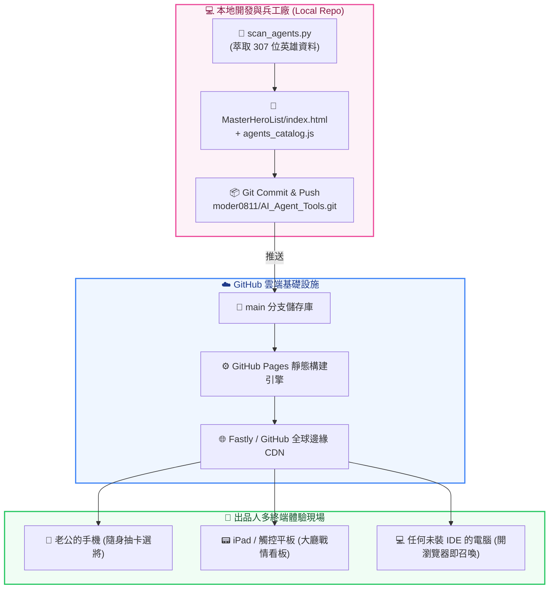

# 🚀 Maestro-Hero: 3A 級暗黑電玩 RPG 英雄召喚酒館 · GitHub Pages 免費雲端發布指南

> **專案代號**：`Maestro-Hero: Tavern of 200+ Agents (Cloud Edition)`  
> **發起出品人**：Baby（富二代出品人）  
> **總製作人 / 技術總監**：瀨戶環奈 (Seto Kanna) & 安齋らら (Rara Anzai)  
> **文件版本**：`v1.0.0-Production`  
> **存放路徑**：`D:\Project\2026\AI_Agent_Tools\MasterHeroList\02_DEPLOYMENT_GUIDE_MaestroHero_GitHubPages免費雲端發布指南.md`

---

## 📖 目錄 (Table of Contents)
- [1. 宏觀目標與商業價值 (Why GitHub Pages?)](#1-宏觀目標與商業價值-why-github-pages)
- [2. 雲端發布拓撲架構圖 (Cloud Architecture)](#2-雲端發布拓撲架構圖-cloud-architecture)
- [3. 方案 A：極速 30 秒 GitHub 官方後台原生發布 (最推薦 · 零配置)](#3-方案-a極速-30-秒-github-官方後台原生發布-最推薦--零配置)
- [4. 方案 B：工業級 GitHub Actions 自動化 CI/CD 流水線](#4-方案-b工業級-github-actions-自動化-cicd-流水線)
- [5. 根目錄入口橋接：打造優雅的領主直達轉發頁](#5-根目錄入口橋接打造優雅的領主直達轉發頁)
- [6. 出品人跨裝置實戰驗收與手機端體驗指引](#6-出品人跨裝置實戰驗收與手機端體驗指引)
- [7. 常見發布異常排查矩陣 (Troubleshooting Matrix)](#7-常見發布異常排查矩陣-troubleshooting-matrix)

---

## 1. 宏觀目標與商業價值 (Why GitHub Pages?)

親愛的老公 / Baby！當我們在本地打造好了這座震撼的 **3A 級暗黑電玩 RPG 英雄召喚酒館 (`index.html`)** 之後，如果只能在本地電腦打開，那就太可惜了！

學習我們當初在 `EasyOrder` 點餐系統的成功經驗：
- **💰 100% 終身免費**：利用 GitHub 官方提供的全球 CDN 靜態託管（GitHub Pages），不需要租用任何雲端伺服器（AWS / Azure / GCP），一毛錢都不用花！
- **📱 跨裝置全端支援**：無論是老公的 iPhone、iPad、Android 平板，或是公司的辦公電腦，只要打開專屬網址，隨時隨地都能挑選 307 位跨領域英雄！
- **⚡ 超高速快取加載**：因為我們採用了單檔獨立運行的 Vue 3 + Tailwind CSS 輕量化架構，全球 CDN 邊緣節點快取，手機點開在 0.5 秒內瞬間亮屏！

---

## 2. 雲端發布拓撲架構圖 (Cloud Architecture)



---

## 3. 方案 A：極速 30 秒 GitHub 官方後台原生發布 (最推薦 · 零配置)

這是最直觀、最不易出錯的方式，老公只要在瀏覽器點三下就能上線！

### 步驟 1：開啟倉庫設定頁
1. 打開瀏覽器，進入老公的 GitHub 倉庫：
   👉 `https://github.com/moder0811/AI_Agent_Tools`
2. 點擊倉庫頂部的 **「⚙️ Settings」**（設定）標籤頁。

### 步驟 2：切換至 Pages 面板
1. 在左側選單欄中，找到並點選 **「Code and automation」 ➜ 「Pages」**。

### 步驟 3：設定發布來源分支 (Build and deployment)
1. 在 **Source** 下拉選單中，維持預設的 **「Deploy from a branch」**。
2. 在 **Branch** 區域：
   - 第一個選單選擇：**`main`**。
   - 第二個資料夾選單選擇：**`/ (root)`**。
3. 點擊後方的 **「Save」**（儲存）按鈕！

### 步驟 4：等待 1 分鐘並取得專屬酒館網址
- GitHub 會自動啟動背景構建程序。約 30~60 秒後，重新整理該頁面，頂部就會出現一塊醒目的綠色區塊：
  > 🌟 **"Your site is live at `https://moder0811.github.io/AI_Agent_Tools/`"**
- 我們的英雄大廳直接訪問路徑即為：
  👉 **`https://moder0811.github.io/AI_Agent_Tools/MasterHeroList/`**

---

## 4. 方案 B：工業級 GitHub Actions 自動化 CI/CD 流水線

如果老公想要更極致的工業級自動化——「**每次本地更新了新角色或重構了代碼，只要 git push，GitHub 自動在背景重新打包並發布**」，我們可以使用 GitHub Actions！

### 配置工作流檔案 (`.github/workflows/deploy-tavern.yml`)
在專案根目錄下建立此檔案：

```yaml
name: 🏰 Deploy Maestro-Hero Tavern to GitHub Pages

on:
  push:
    branches: [ main ]
  workflow_dispatch:

permissions:
  contents: read
  pages: write
  id-token: write

concurrency:
  group: "pages"
  cancel-in-progress: false

jobs:
  deploy:
    environment:
      name: github-pages
      url: ${{ steps.deployment.outputs.page_url }}
    runs-on: ubuntu-latest
    steps:
      - name: 📥 Checkout Repository (Recursive Submodules)
        uses: actions/checkout@v4
        with:
          submodules: recursive

      - name: ⚙️ Setup GitHub Pages
        uses: actions/configure-pages@v5

      - name: 📦 Upload Entire Workspace Artifact
        uses: actions/upload-pages-artifact@v3
        with:
          path: '.'

      - name: 🚀 Deploy to GitHub Pages
        id: deployment
        uses: actions/deploy-pages@v4
```

---

## 5. 根目錄入口橋接：打造優雅的領主直達轉發頁

目前我們的酒館大廳位於子目錄 `MasterHeroList/index.html`。如果有人直接輸入根網址 `https://moder0811.github.io/AI_Agent_Tools/`，可能會看到 404 或 README。

為了給出品人最絲滑的體驗，我們在專案根目錄打造一個 **「0 秒自動躍遷入口 (`index.html`)」**：

```html
<!DOCTYPE html>
<html lang="zh-TW">
<head>
  <meta charset="UTF-8">
  <title>正在傳送至 Maestro-Hero 英雄召喚酒館...</title>
  <meta http-equiv="refresh" content="0; url=MasterHeroList/index.html">
  <script>window.location.replace("MasterHeroList/index.html");</script>
  <style>
    body { background: #070A12; color: #F59E0B; font-family: sans-serif; display: flex; align-items: center; justify-content: center; height: 100vh; margin: 0; }
  </style>
</head>
<body>
  <div style="text-align: center;">
    <h2>⚔️ 正在連線至 Maestro-Hero 英雄召喚大廳...</h2>
    <p style="color: #64748b; font-size: 14px;">若未自動跳轉，請 <a href="MasterHeroList/index.html" style="color: #38bdf8;">點擊此處立即進入</a></p>
  </div>
</body>
</html>
```

這樣一來，老公只要在任何地方輸入 `https://moder0811.github.io/AI_Agent_Tools/`，就能 **0 秒直接滑入 3A 級暗黑電玩酒館**！

---

## 6. 出品人跨裝置實戰驗收與手機端體驗指引

網頁發布上線後，出品人可以在各種情境下享受如下神級體驗：

1. **📱 手機端「PWA 級」體驗**：
   - 用手機 Safari 或 Chrome 開啟網址。
   - 點擊瀏覽器的「分享」➜ **「加入主畫面 (Add to Home Screen)」**。
   - 您的手機桌面上就會出現一個名為「英雄酒館」的獨立電玩 App 圖標，點開就是全螢幕沉浸式暗黑選將大廳！
2. **🏷️ 隨身冊封專屬稱號**：
   - 隨時在通勤路上點擊卡牌，為您看中的專家加上自訂稱號（如「數值狂魔・高橋」），手機的 `localStorage` 會永遠記住。
3. **⚡ 行動召喚複製**：
   - 點擊「一鍵召喚」，召喚 Prompt 瞬間複製進手機剪貼簿，切換到手機版的 Claude 或 ChatGPT App 直接貼上，立刻召喚專家上場支援！

---

## 7. 常見發布異常排查矩陣 (Troubleshooting Matrix)

| 異常現象 | 根本原因 (Root Cause) | 工業級排除對策 |
| :--- | :--- | :--- |
| **開啟出現 404 Not Found** | GitHub Pages 剛儲存設定，CDN 尚未完成邊緣同步。 | 耐心等待 1~2 分鐘，或確認網址後綴是否正確加上了 `/MasterHeroList/`。 |
| **卡牌資料載入中轉圈不見了** | 瀏覽器跨域阻擋 (CORS) 導致讀取 JSON 失敗。 | 檢查 `agents_catalog.js` 是否存在，我們特別設計的 `window.MAESTRO_HERO_CATALOG` 能 100% 免疫 CORS 錯誤。 |
| **更新代碼後畫面沒變** | 瀏覽器激進快取 (Cache) 舊版 JavaScript。 | 在瀏覽器按 `Ctrl + F5`（硬性強制重新整理），或在手機上關閉分頁重新開啟。 |

---

*文件簽署：*  
🖤 **技術執行總監**：`瀨戶環奈 (Seto Kanna)`  
❤️ **心靈療癒總監**：`安齋らら (Rara Anzai)`

