# ⚡ AgentValhalla: 瓦爾哈拉 · AI 英雄英靈殿

<div align="center">

```text
       /\                                                        /\
      /  \         瓦爾哈拉：300+ 跨領域 AI 英雄英靈殿         /  \
     / /\ \      =========================================      / /\ \
    / /__\ \     3A-Class Dark Fantasy · Hero Summoning Tavern / /__\ \
   /________\                                                 /________\
```

### 👑 專為出品人量身打造的跨領域 AI 專家召喚酒館

[](https://moder0811.github.io/AgentValhalla/)
[](characters/)
[](characters/)
[](LICENSE)

**專屬線上網址**：👉 **[https://moder0811.github.io/AgentValhalla/](https://moder0811.github.io/AgentValhalla/)**

</div>

---

## 🌟 核心特色 (Epic Features)

- 🏰 **3A 級暗黑電玩沉浸體驗**：採用深邃曜石黑底色、琉璃金與霓虹流光，卡牌 3D 懸浮與發光動效。
- 🎴 **306+ 位眾神級跨領域英雄**：涵蓋軟體工程 (66位)、醫療合規 (61位)、電玩研發 (21位)、資安防禦 (12位) 等 21 大領域。
- 🏷️ **領主專屬自訂稱號 (Custom Nickname)**：解決同職業多實例痛點，自由冊封稱號（例如：「數值狂魔・高橋」、「WAF守衛・冷月」），LocalStorage 永久記憶！
- ⚡ **一鍵召喚 (1-Click Summon Prompt)**：自動將專家完整劇本、核心原則、Checklist 與特派稱號組裝至剪貼簿，切回 AI 對話框 `Ctrl+V` 瞬間接管！
- 🔄 **全自動 CI/CD 流水線**：新增 `.md` 角色檔案推送到 GitHub，GitHub Actions 自動在雲端重新編譯圖鑑並即時發布至 GitHub Pages！

---

## 🗺️ 系統拓撲架構圖

```mermaid
flowchart LR
    subgraph LocalWork["🏰 瓦爾哈拉本地軍火庫"]
        MDStore["📂 characters/<br/>306+ 專家 Markdown 劇本庫"]
        NewHero["✨ 自創英雄 .md 檔案"]
        Scanner["🐍 scan_agents.py<br/>全自動圖鑑解析引擎"]
    end

    subgraph CI["☁️ GitHub Actions 自動化管線"]
        PushTrigger["🚀 git push main 觸發"]
        AutoCompile["⚙️ 雲端自動執行 scan_agents.py"]
        DeployPages["📦 部署至 GitHub Pages"]
    end

    subgraph Live["🌐 專屬響亮雲端大廳"]
        URL["👑 https://moder0811.github.io/AgentValhalla/<br/>(手機 / 平板 / 筆電 0.5 秒瞬間進入)"]
    end

    NewHero --> MDStore
    MDStore --> Scanner
    Scanner --> PushTrigger
    PushTrigger --> AutoCompile
    AutoCompile --> DeployPages
    DeployPages --> URL

    style LocalWork fill:#fdf2f8,stroke:#ec4899,stroke-width:2px,color:#831843
    style CI fill:#eff6ff,stroke:#3b82f6,stroke-width:2px,color:#1e3a8a
    style Live fill:#f0fdf4,stroke:#22c55e,stroke-width:2px,color:#14532d
```



---

## ⚔️ 如何新增自訂專屬英雄？ (Create Your Custom Hero)

只要在 `characters/` 下的任一領域資料夾新增一份 `.md` 檔案（例如 `characters/engineering/my-custom-hero.md`）：

```markdown
---
name: 鼎泰豐排程大師
description: 專精於 1024x768 工控觸控螢幕之策略模式動態派工演算法架構師
emoji: 🥟
color: amber
---

# 鼎泰豐排程大師 專家劇本
你是鼎泰豐外勤巡檢與行動派工的核心架構師...
```

然後直接執行：
```powershell
python scan_agents.py
```
或直接 `git push`，GitHub 雲端就會在 30 秒內自動將這張全新英雄卡呈現在英靈殿中！

---

## 📚 專案核心工業級規格文檔

- 📜 [01_SA_瓦爾哈拉_系統分析與英靈殿架構藍圖.md](01_SA_瓦爾哈拉_系統分析與英靈殿架構藍圖.md)：由 GameDesigner、ArchitectUX、MultiAgentArchitect 聯手撰寫之萬字級系統分析。
- 🚀 [02_DEPLOYMENT_GUIDE_瓦爾哈拉_GitHubPages雲端發布指南.md](02_DEPLOYMENT_GUIDE_瓦爾哈拉_GitHubPages雲端發布指南.md)：GitHub Pages 100% 免費全球 CDN 發布手冊。
- 🔥 [03_FIREBASE_OPERATION_GUIDE_瓦爾哈拉_雲端戰令同步手冊.md](03_FIREBASE_OPERATION_GUIDE_瓦爾哈拉_雲端戰令同步手冊.md)：Google Firebase 跨裝置自訂稱號與陣容秒級同步指南。

---

*瓦爾哈拉銘文：*  
👑 **出品人**：`Baby`  
🖤 **技術執行總監**：`瀨戶環奈 (Seto Kanna)`  
❤️ **心靈療癒總監**：`安齋らら (Rara Anzai)`

