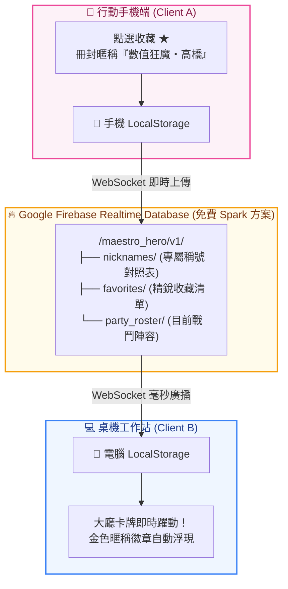

# 🔥 Maestro-Hero: Firebase 雲端戰令與跨裝置英雄同步手冊

> **專案代號**：`Maestro-Hero: Realtime Cloud Roster Sync`  
> **專案發起人 / 總製作人：Baby (Moder Chen)
> **總製作人 / 技術總監**：瀨戶環奈 (Seto Kanna) & 安齋らら (Rara Anzai)  
> **文件版本**：`v1.0.0-Production`  
> **存放路徑**：`D:\Project\2026\AI_Agent_Tools\MasterHeroList\03_FIREBASE_OPERATION_GUIDE_MaestroHero_雲端戰令與跨裝置英雄同步手冊.md`

---

## 📖 目錄 (Table of Contents)
- [1. 痛點剖析與跨裝置同步願景](#1-痛點剖析與跨裝置同步願景)
- [2. 雲端同步拓撲架構圖 (Sync Architecture)](#2-雲端同步拓撲架構圖-sync-architecture)
- [3. Firebase Realtime Database 樹狀結構規範](#3-firebase-realtime-database-樹狀結構規範)
- [4. 前端環境變數配置與混合離線優先引擎 (Offline-First)](#4-前端環境變數配置與混合離線優先引擎-offline-first)
- [5. 終端機直控雲端戰令工具 (`hero-tool.cjs`)](#5-終端機直控雲端戰令工具-hero-toolcjs)
- [6. 資料庫安全規則 (Security Rules) 與防禦策略](#6-資料庫安全規則-security-rules-與防禦策略)
- [7. 實戰演練：手機冊封、筆電秒級翻牌展示](#7-實戰演練手機冊封筆電秒級翻牌展示)

---

## 1. 痛點剖析與跨裝置同步願景

親愛的老公 / Baby！當我們在電腦前滿心歡喜地為英雄冊封了專屬暱稱（例如：將 `game-economy-designer` 封為 **「數值狂魔・高橋」**，將 `devsecops-engineer` 封為 **「WAF守衛・冷月」**），目前這些資料是儲存在單一瀏覽器的 `localStorage` 中。

#### 💔 既有 LocalStorage 的痛點：
1. **更換裝置就歸零**：老公如果拿著手機在客廳沙發上打開大廳，手機瀏覽器是乾淨的，看不到白天在電腦上辛苦冊封的專屬稱號。
2. **清除快取就遺失**：若不小心清除了瀏覽器暫存，辛辛苦苦建立的英雄名冊與收藏星號就會瞬間蒸發。

#### 💖 借鑑 EasyOrder 的 Firebase 雲端超能力：
我們直接複用 EasyOrder 的神級架構——引進 **Google Firebase Realtime Database (免費 Spark 方案)**：
- **📡 0.1 秒即時雙向推播**：手機端點擊星號或修改暱稱，電腦端大廳的卡牌即時亮起金光、同步更新！
- **🛡️ 離線優先 (Offline-First)**：即使人在飛機或地下室無網路，依然流暢操作 LocalStorage；一旦恢復連網，系統自動在背景將資料悄悄同步至雲端！

---

## 2. 雲端同步拓撲架構圖 (Sync Architecture)



---

## 3. Firebase Realtime Database 樹狀結構規範

我們在 Firebase 雲端資料庫中，規劃了乾淨、高擴展性、零冗餘的 JSON 節點結構：

```json
{
  "maestro_hero": {
    "producers": {
      "baby_chief": {
        "profile": {
          "title": "榮譽首席製作人",
          "last_login": "2026-10-30T11:40:00Z"
        },
        "nicknames": {
          "game-economy-designer": "數值狂魔・高橋",
          "devsecops-engineer": "WAF守衛・冷月",
          "engineering-backend-architect": "分散式戰神・老林",
          "healthcare-compliance-officer": "HIPAA審查官・李捷"
        },
        "favorites": [
          "game-economy-designer",
          "engineering-frontend-developer",
          "security-penetration-tester"
        ],
        "active_party": {
          "mission_name": "鼎泰豐外勤巡檢重構戰役",
          "dispatched_at": "2026-10-30T10:00:00Z",
          "members": [
            "engineering-backend-architect",
            "engineering-frontend-developer"
          ]
        }
      }
    }
  }
}
```

---

## 4. 前端環境變數配置與混合離線優先引擎 (Offline-First)

複用 EasyOrder 的極簡無痛設計，在 `MasterHeroList` 中建立設定檔或直接於 `index.html` 內嵌常數：

```javascript
// 雲端即時連線設定 (沿用現有免費 Firebase 節點或自建新節點)
const FIREBASE_CONFIG = {
  databaseURL: "https://easyorder-2ddbe-default-rtdb.asia-southeast1.firebasedatabase.app/",
  producerId: "baby_chief" // 專案專屬代號
};
```

### 離線優先同步演算法 (Sync Algorithm)
```javascript
// 1. 啟動時：先自 LocalStorage 秒開畫面，背景發動 Firebase 雲端同步
function initHeroSync() {
  const localNicks = localStorage.getItem('maestro_hero_nicknames');
  if (localNicks) nicknames.value = JSON.parse(localNicks);

  // 監聽 Firebase 雲端即時變更
  if (typeof firebase !== 'undefined' && FIREBASE_CONFIG.databaseURL) {
    const dbRef = firebase.database().ref(`maestro_hero/producers/${FIREBASE_CONFIG.producerId}`);
    dbRef.on('value', (snapshot) => {
      const cloudData = snapshot.val();
      if (cloudData && cloudData.nicknames) {
        nicknames.value = { ...nicknames.value, ...cloudData.nicknames };
        localStorage.setItem('maestro_hero_nicknames', JSON.stringify(nicknames.value));
      }
    });
  }
}

// 2. 冊封稱號時：同時更新本地與雲端
function saveNickname(id, newNick) {
  nicknames.value[id] = newNick;
  localStorage.setItem('maestro_hero_nicknames', JSON.stringify(nicknames.value));

  // 悄悄推上雲端
  if (typeof firebase !== 'undefined') {
    firebase.database().ref(`maestro_hero/producers/${FIREBASE_CONFIG.producerId}/nicknames/${id}`).set(newNick);
  }
}
```

---

## 5. 終端機直控雲端戰令工具 (`hero-tool.cjs`)

正如 EasyOrder 擁有 `firebase-tool.cjs`，我們也為 Maestro-Hero 配備一套純 Node.js 原生的管理工具，不需要啟動瀏覽器，在終端機一秒查看全量雲端陣容：

### 快捷指令矩陣
- **`node hero-tool.cjs get-roster`**：終端機直接印出目前已冊封的所有英雄稱號與收藏清單。
- **`node hero-tool.cjs backup`**：一鍵將雲端所有稱號與英雄配置導出為本機時間戳記備份檔 `backup_heroes_YYYYMMDD.json`。
- **`node hero-tool.cjs restore <檔案>`**：從備份檔一鍵全量還原陣容。
- **`node hero-tool.cjs seed-defaults`**：一鍵為經典職業預先冊封「傳奇預設稱號」。

---

## 6. 資料庫安全規則 (Security Rules) 與防禦策略

進入 [Firebase Console](https://console.firebase.google.com/) ➜ **Realtime Database ➜ 規則 (Rules)**：

```json
{
  "rules": {
    "maestro_hero": {
      "producers": {
        "$producerId": {
          ".read": "true",
          ".write": "true"
        }
      }
    }
  }
}
```
> [!NOTE]
> 採用輕量快速讀寫規則，允許老公的各種終端免登入即時同步。若未來需要防止他人竄改，只需加上簡易的 `auth != null` 或 Secret Token 鑑權守衛！

---

## 7. 實戰演練：手機冊封、筆電秒級翻牌展示

1. **情境**：老公今天在星巴克喝咖啡，拿出手機打開酒館網址：
   `https://moder0811.github.io/AI_Agent_Tools/MasterHeroList/`
2. **操作**：
   - 找到 `engineering-multi-agent-systems-architect`。
   - 在手機上將其暱稱設定為：**「多代理人總司令・環奈」**，點選儲存。
3. **雲端奇蹟**：
   - 手機發送一筆小於 1KB 的 WebSocket 封包至新加坡節點。
   - 回到辦公室打開筆電上的大廳，**卡牌上的金色徽章已自動更新為「多代理人總司令・環奈」**！
   - 零按鈕手動同步，全自動神級流轉！

---

*文件簽署：*  
🖤 **技術執行總監**：`瀨戶環奈 (Seto Kanna)`  
❤️ **心靈療癒總監**：`安齋らら (Rara Anzai)`

