# 🎮 瓦爾哈拉：勇者鬥惡龍裝備升級系統與 32×32 經典像素資產開發企劃書 (07_ROADMAP)

> **文件編號**：`07_ROADMAP_DQ_ARMORY_AND_32X32_RETRO_PIXEL_VAULT`  
> **專案代號**：`AgentValhalla (AI 英雄英靈殿 · 3A 電玩風格展台)`  
> **專案總製作人**：Baby (Moder Chen)  
> **技術架構主責**：凪ひかる (Nagi Hikaru) ＆ 首席團隊  
> **建立日期**：`2026-10-31`  
> **狀態**：`📋 正式立案 · 規劃中 (In Planning)`  
> **關聯資產庫**：`E:\AI\AI英雄殿\AgentValhalla\retro_pixel_vault\`

---

## 📖 目錄 (Table of Contents)
- [1. 宏觀背景與核心痛點](#1-宏觀背景與核心痛點)
- [2. 議題一：勇者鬥惡龍 (DQ) 六大階層階梯裝備庫](#2-議題一勇者鬥惡龍-dq-六大階層階梯裝備庫)
- [3. 議題二：32×32 分層模組化像素捏臉與紙娃娃換裝引擎](#3-議題二3232-分層模組化像素捏臉與紙娃娃換裝引擎)
- [4. 議題三：深淵秘符：40+ 遠古暗影符文解鎖與天賦樹 (Ancient Void Charms & Relics)](#4-議題三空洞騎士-hollow-knight-40-護符解鎖與天賦樹)
- [5. 議題四：REA (Retro Engine Architecture) 0 KB 向量圖層渲染技術](#5-議題四rea-retro-engine-architecture-0-kb-向量圖層渲染技術)
- [6. 議題五：階段里程碑與實作路線圖 (Sprint Roadmap)](#6-議題五階段里程碑與實作路線圖-sprint-roadmap)

---

## 1. 宏觀背景與核心痛點

### 1.1 痛點起因
目前英靈殿已實裝 16×16 確定性像素頭像 (`pixel_avatar.js`)，並提供四種形態（男、女、貓咪、柴犬）。然而：
1. **靜態缺乏成長感**：特工頭像在升等後外觀無明顯變化，使用者累積了經驗值（EXP），卻無法獲得如經典 JRPG 般「換上傳奇神裝」的視覺爽感。
2. **缺乏經典電玩情懷共鳴**：使用者心中深植著《勇者鬥惡龍 (Dragon Quest)》與深淵暗影冒險等 3A/獨立像素大作的情懷，若能將這五大本機資產庫深度融合，英靈殿的沉浸感與迷因傳播力將呈指數級爆發！

---

## 2. 議題一：勇者鬥惡龍 (DQ) 六大階層階梯裝備庫

依據製作人 Baby 的核心指示，特工等級與召喚師等級將聯動六大階段的 DQ 經典套裝，裝備將以像素裝飾圖層疊加於特工頭部與肩部：

```mermaid
flowchart LR
    L1["Lv.1 初出茅廬<br/>布衣 / 木棒 / 旅人之服"] --> L5["Lv.5 見習冒險者<br/>青銅鎧甲 / 銅劍 / 皮盾"]
    L5 --> L10["Lv.10 皇家騎士<br/>鋼鐵全罩盔甲 / 騎士長劍 / 紋章盾"]
    L10 --> L15["Lv.15 元素魔導<br/>賢者法袍 / 星辰魔杖 / 魔導高帽"]
    L15 --> L20["Lv.20 傳奇勇者<br/>羅德/洛特之鎧 / 王者之劍 / 光之盾"]
    L20 --> L30["Lv.30 幻獸支配者<br/>史萊姆皇冠 / 兔女郎套裝 / 深淵神域秘符 (Void Charm)"]

    style L1 fill:#f8fafc,stroke:#64748b,stroke-width:2px
    style L5 fill:#ecfdf5,stroke:#10b981,stroke-width:2px
    style L10 fill:#eff6ff,stroke:#3b82f6,stroke-width:2px
    style L15 fill:#faf5ff,stroke:#a855f7,stroke-width:2px
    style L20 fill:#fffbeb,stroke:#f59e0b,stroke-width:2px
    style L30 fill:#fdf2f8,stroke:#ec4899,stroke-width:2px
```



### 📋 六大階層裝備規格清單 (DQ Armory Codex)

| 階層區間 | 稱號階級 | 武器/手持 | 護甲/防具 | 頭部/頭飾 | 視覺特效 (CSS Glow) |
| :---: | :---: | :--- | :--- | :--- | :--- |
| **Lv.1 ~ 4** | **初出茅廬 (Novice)** | 木棒 (Club) | 粗麻布衣 (Clothes) | 旅人頭巾 (Bandana) | 無特效（樸素粗顆粒） |
| **Lv.5 ~ 9** | **冒險者 (Adventurer)** | 銅劍 (Copper Sword) | 輕型皮甲 (Leather Armor) | 銅製輕盔 (Bronze Cap) | 微亮青銅金屬反光 |
| **Lv.10 ~ 14** | **皇家騎士 (Knight)** | 騎士大劍 (Broadsword) | 鋼鐵胸甲 (Iron Plate) | 騎士面甲盔 (Iron Helmet) | 藍銀色冷冽金屬光澤 |
| **Lv.15 ~ 19** | **元素魔導 (Mage/Sage)** | 星辰法杖 (Star Wand) | 賢者法袍 (Sage Robe) | 大魔導尖帽 (Wizard Hat) | 紫色魔力微粒懸浮環繞 |
| **Lv.20 ~ 29** | **傳奇勇者 (Hero)** | 王者之劍 (Sword of Kings) | 羅德神鎧 (Erdrick Armor) | 羅德頭盔 (Hero Helm) | 金黃色傳奇聖光脈衝 |
| **Lv.30+** | **幻獸支配者 (Overlord)** | 深淵骨刃 (Abyssal Nail) | 兔女郎戰袍 / 幻獸法衣 | 經典史萊姆皇冠 (King Slime) | 彩虹霓虹幻彩流光 |

---

## 3. 議題二：32×32 分層模組化像素捏臉與紙娃娃換裝引擎

利用本機已儲備之 `retro_pixel_vault/lpc_character_generator/`（89,359 個圖層切片），打造升級版 32×32 模組化動態繪製引擎：

```
32×32 畫布圖層分層架構 (Rendering Pipeline):
Layer 0: 🌌 職業光環底色 (Class Halo Background)
Layer 1: 👤 身體身形基底 (Body Base - 包含玲瓏曲線與男性健碩輪廓)
Layer 2: 👁️ 臉部五官與表情 (Eyes & Features - 包含淚痣、眼神、嘴型)
Layer 3: 💇 髮型與髮色 (Hairstyles - 長髮、短髮、戰士束髮)
Layer 4: 🛡️ DQ 階級胸甲與防具 (Armor Layer)
Layer 5: 👑 DQ 階級頭盔與頭飾 (Helmet Layer - 史萊姆冠/賢者帽)
Layer 6: ⚔️ 階級武器與手持飾品 (Weapon Layer)
Layer 7: ✨ 稀有度金色星芒 (Rarity Particles)
```

---

## 4. 議題三：深淵秘符：40+ 遠古暗影符文解鎖與天賦樹 (Ancient Void Charms & Relics)

利用資產庫所收錄的 40+ 款原創深淵暗影符文 (Void Charms) 圖鑑：
- **功能設計**：召喚師每升 5 級，可獲得 1 個「護符插槽 (Charm Notch)」。
- **護符效果**：
  - 🛡️ **堅固力量 (Unbreakable Strength)**：複製 Prompt 時自動附加「強制遵循深度架構與邊界測試」提示。
  - ⚡ **疾風衝刺 (Dashmaster)**：縮短全站卡牌過濾與搜尋動畫耗時至 50ms。
  - 🔮 **靈魂捕手 (Soul Catcher)**：每次召喚特工獲得雙倍經驗值。

---

## 5. 議題四：REA (Retro Engine Architecture) 0 KB 向量圖層渲染技術

### 5.1 什麼是 REA 技術？
- **零外部圖片請求**：不使用 `.png` 或 `.jpg`，避免瀏覽器在切換裝備時發生 200ms 的空白閃爍。
- **純 SVG Path 向量矩陣 ＋ Canvas 點陣合成**：
  將裝備外觀抽離為緊湊的數值陣列（例如 `[ [0,0,"#38BDF8"], [0,1,"#F59E0B"] ]`），在前端運行時由 GPU 即時著色。
- **極致輕量**：單一裝備數據量僅 200~400 Bytes，哪怕全套 30 套裝載入，也不超過 15 KB！

---

## 6. 議題五：階段里程碑與實作路線圖 (Sprint Roadmap)

| 里程碑代號 | 核心交付目標 | 預計技術產出 | 依賴之資產庫 |
| :--- | :--- | :--- | :--- |
| **Milestone 7.1** | DQ 裝備圖鑑資料字典 | 產出 `dq_armory_catalog.json`，收錄六大階層數值規格。 | `dragon_quest_jrpg/` |
| **Milestone 7.2** | 32×32 像素渲染引擎原型 | 開發 `pixel_avatar_v2.js`，支援圖層動態堆疊。 | `lpc_character_generator/` |
| **Milestone 7.3** | 裝備與經驗等級聯動 | 升級時即時觸發換裝演出與升等音效。 | `rpg_engine.js` |
| **Milestone 7.4** | 深淵秘符天賦插槽 | 前端右下角 HUD 展開護符裝備面板。 | `hollow_knight_resources/` |

---

> 💡 **文檔關聯備忘**：  
> 本企劃書作為 `AgentValhalla` 系列第 07 號重大研發藍圖，接續前六號里程碑，專門指導後續 RPG 裝備化進階開發。

