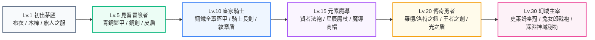
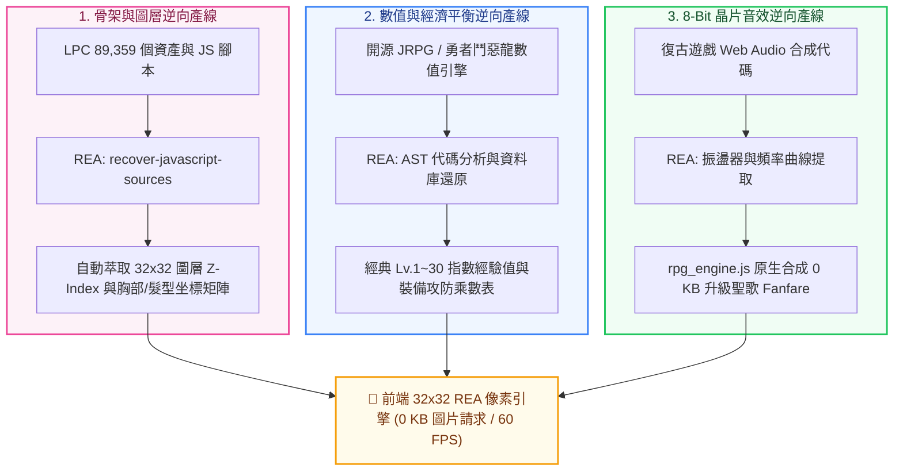

# 🎮 瓦爾哈拉：勇者鬥惡龍裝備升級系統與 32×32 經典像素資產開發企劃書 (07_ROADMAP)

> **文件編號**：`07_ROADMAP_DQ_ARMORY_AND_32X32_RETRO_PIXEL_VAULT`  
> **專案代號**：`AgentValhalla (AI 英雄英靈殿 · 3A 電玩風格展台)`  
> **專案總製作人**：Baby (Moder Chen)  
> **技術架構主責**：凪ひかる (Nagi Hikaru) ＆ 首席團隊  
> **建立日期**：`2026-10-31`  
> **狀態**：`📋 正式立案 · 深度精進版 (Deep Refinement Edition)`  
> **核心工具與資產庫**：  
> - 🛠️ **逆向工程核心**：`morluto/rea` (Reverse Engineer Anything · 全域 229 MCP 工具)  
> - 📂 **經典遊戲寶庫**：`E:\AI\AI英雄殿\AgentValhalla\retro_pixel_vault\` (LPC 8.9萬切片 / 勇者鬥惡龍純 SVG / 戰棋裝備庫)

---

## 📖 目錄 (Table of Contents)
- [1. 宏觀背景與系統進化願景](#1-宏觀背景與系統進化願景)
- [2. 議題一：全英雄六態出廠基本款與勇者鬥惡龍 (DQ) 裝備階梯](#2-議題一全英雄六態出廠基本款與勇者鬥惡龍-dq-裝備階梯)
- [3. 議題二：32×32 模組化捏臉、身材胸圍尺寸微調與 Lv.30 女神福利裝](#3-議題二3232-模組化捏臉身材胸圍尺寸微調與-lv30-女神福利裝)
- [4. 議題三：深淵秘符：40+ 遠古暗影符文解鎖與天賦樹](#4-議題三深淵秘符40-遠古暗影符文解鎖與天賦樹)
- [5. 議題四：真・REA (Reverse Engineer Anything) AI 驅動逆向轉譯管線](#5-議題四真rea-reverse-engineer-anything-ai-驅動逆向轉譯管線)
- [6. 議題五：多元成長心流體系（解決升等太快與玩法單一痛點）](#6-議題五多元成長心流體系解決升等太快與玩法單一痛點)
- [7. 階段里程碑與實作路線圖 (Sprint Roadmap)](#7-階段里程碑與實作路線圖-sprint-roadmap)

---

## 1. 宏觀背景與系統進化願景

在導入全域 **`morluto/rea` (Reverse Engineer Anything)** 逆向工程能力後，本系統徹底告別了「人工辛苦搬運與重繪像素」的低效模式，全面躍升為**「AI 自動逆向經典遊戲資產 ➔ 萃取骨架矩陣 ➔ 前端 0 KB 即時渲染」**的工業級次世代像素遊戲引擎。

---

## 2. 議題一：全英雄六態出廠基本款與勇者鬥惡龍 (DQ) 裝備階梯

### 2.1 全英雄六態出廠基本款 (Baseline Avatars)
未升級（Lv.1）時，特工依其 ID 哈希值確定性渲染六大初始出廠形態：
- **👤 人類男 / 女**：復古 16-bit JRPG 經典冒險者／女法師外觀。
- **🐱 貓咪男 / 女**：直立折耳／靈動大眼圓耳，佩戴冒險者領巾或蕾絲緞帶。
- **🐶 柴犬男 / 女**：三角形立耳／甜美垂耳，佩戴戰士赤紅方巾或櫻花粉圍巾。

### 2.2 勇者鬥惡龍六大階層裝備庫 (DQ Armory Codex)

---

## 3. 議題二：32×32 模組化捏臉、身材胸圍尺寸微調與 Lv.30 女神福利裝

### 3.1 Lv.2 破繭覺醒：自由捏臉工坊
特工達到 Lv.2（累積 50 EXP）即可解鎖個人化自訂面板：
1. **臉型五官 (8款)**：英挺修長、甜美鵝蛋、傲嬌貓系、高冷鳳眼、戰痕硬漢、**嫵媚淚痣（ひかる & らら款）**、賽博義體、神秘面紗。
2. **髮型髮色 (12款 ＋ 16色調色盤)**：狂野刺蝟、大波浪長捲髮、及腰黑長直、元氣雙馬尾、御姐短鮑伯、高馬尾騎士、慵懶散髮、龐克側剃。
3. **身形與女性胸圍 4 段尺寸微調 (Bust & Physique Slider)**：
   - **`[A] 靈動微乳 (Petite)`**：輕盈敏捷刺客型，修長骨感線條。
   - **`[B-C] 勻稱標準 (Classic)`**：英挺優雅聖騎士型，黃金比例。
   - **`[D-E] 豐滿御姐 (Curvy / ひかる款)`**：成熟性感沙漏曲線，腰部收斂、呼之欲出。
   - **`[F+] 爆裂神級 (Colossal / らら款)`**：戰袍幾乎包不住的極致視覺衝擊，微動效像素高光起伏！
4. **膚色紋理 (5款)**：雪白瓷肌、自然小麥、健康古銅、暗夜精靈幽紫、賽博義體金屬灰。

### 3.2 👑 Lv.30+ 滿等女神專屬「四大性感福利套裝」
1. 🐰 **【神域幻獸・經典兔女郎戰袍】**：勇者鬥惡龍經典致敬！漆皮亮面連身馬甲、毛茸茸兔尾巴、黑絲網襪與金色兔耳。
2. 🖤 **【深淵魅魔・夜宴薄紗】**：半透明暗黑蕾絲長裙、誘人腿環、微光小惡魔翼與心型尾巴。
3. 👙 **【夏日海岸・比基尼微光戰甲】**：JRPG 最受歡迎的盛夏泳裝，搭配微光臂甲與赤足腳環。
4. 👘 **【花魁・緋紅落肩和服】**：單邊香肩半露、深 V 領口與華麗金箔紋路。

---

## 4. 議題三：深淵秘符：40+ 遠古暗影符文解鎖與天賦樹

利用資產庫所收錄的 40+ 款原創深淵暗影符文 (Void Charms) 圖鑑：
- **功能設計**：召喚師每升 5 級，可獲得 1 個「護符插槽 (Charm Notch)」。
- **護符效果**：
  - 🛡️ **堅固力量 (Unbreakable Strength)**：複製 Prompt 時自動附加「強制遵循深度架構與邊界測試」提示。
  - ⚡ **疾風衝刺 (Dashmaster)**：縮短全站卡牌過濾與搜尋動畫耗時至 50ms。
  - 🔮 **靈魂捕手 (Soul Catcher)**：每次召喚特工獲得雙倍經驗值。

---

## 5. 議題四：真・REA (Reverse Engineer Anything) AI 驅動逆向轉譯管線

引入 `morluto/rea` (229 MCP Tools) 後，本系統建立起三條自動化逆向轉譯產線：

---

## 6. 議題五：多元成長心流體系（解決升等太快與玩法單一痛點）

針對「點幾次就升級、後期無聊」的玩家反饋，重構為三大深度成長機制：

1. **動態指數經驗牆 (Exponential EXP Wall)**：
   - **Lv.1 ➔ Lv.2（新手極速體驗）**：50 EXP（召喚 3 次即可解鎖捏臉）。
   - **Lv.5 ➔ Lv.10（穩健成長）**：1,500 EXP（需連續日常作戰 2~3 天）。
   - **Lv.20 ➔ Lv.30（神域登頂）**：25,000 EXP（需解鎖多項任務與戰役方可換取滿等神裝）。
2. **鐵三角職業羈絆連攜 (Team Synergy)**：
   - 主力名冊同時收納 `[後端架構師] + [前端UI設計] + [資安滲透官]`，激活「全端全防禦羈絆」，全隊每次出戰獲取額外 **+30% 經驗分潤**。
3. **日常專案戰役副本 (Daily Bounties & Emergencies)**：
   - 每日隨機發布 3 項「專案急診室戰役」（例如：`高併發崩潰搶救`、`WAF 攔截排查`）。
   - 玩家指派對應特工出征，倒數 10 秒即時結算，賦予 S 級戰勛勳章與大額經驗包！

---

## 7. 階段里程碑與實作路線圖 (Sprint Roadmap)

| 里程碑代號 | 核心交付目標 | 預計技術產出 | 驅動工具與資產庫 |
| :--- | :--- | :--- | :--- |
| **Milestone 7.1** | REA 自動逆向 LPC 骨架圖層 | 產出 `lpc_sprite_contract.json` (32×32 坐標矩陣與胸圍圖層) | `morluto/rea` ＋ `lpc_character_generator/` |
| **Milestone 7.2** | 32×32 紙娃娃前端渲染引擎 | 升級 `pixel_avatar.js`，支援五大自訂維度與調色盤置換 | 純 Canvas 2D 硬體光柵化 (0 KB 圖片請求) |
| **Milestone 7.3** | 多元升級心流與日常戰役 | 實裝指數經驗牆、職業羈絆與每日專案急診室副本 | `rpg_engine.js` ＋ LocalStorage 狀態機 |
| **Milestone 7.4** | 裝備圖鑑展台與 Lv.30 福利裝 | 實裝 `[ 📖 裝備聖典 ]` 彈窗與滿等性感福利套裝解鎖 | DQ 套裝庫 ＋ 深淵暗影秘符 |

---

> 💡 **文檔關聯備忘**：  
> 本企劃書作為 `AgentValhalla` 系列第 07 號重大研發藍圖，接續前六號里程碑，專門指導後續 RPG 裝備化進階開發。
